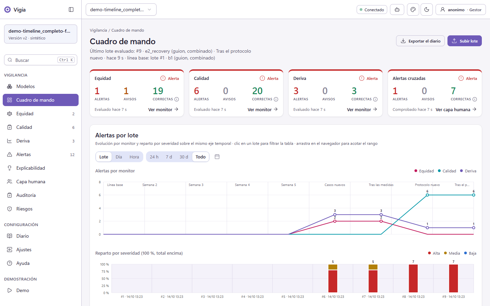
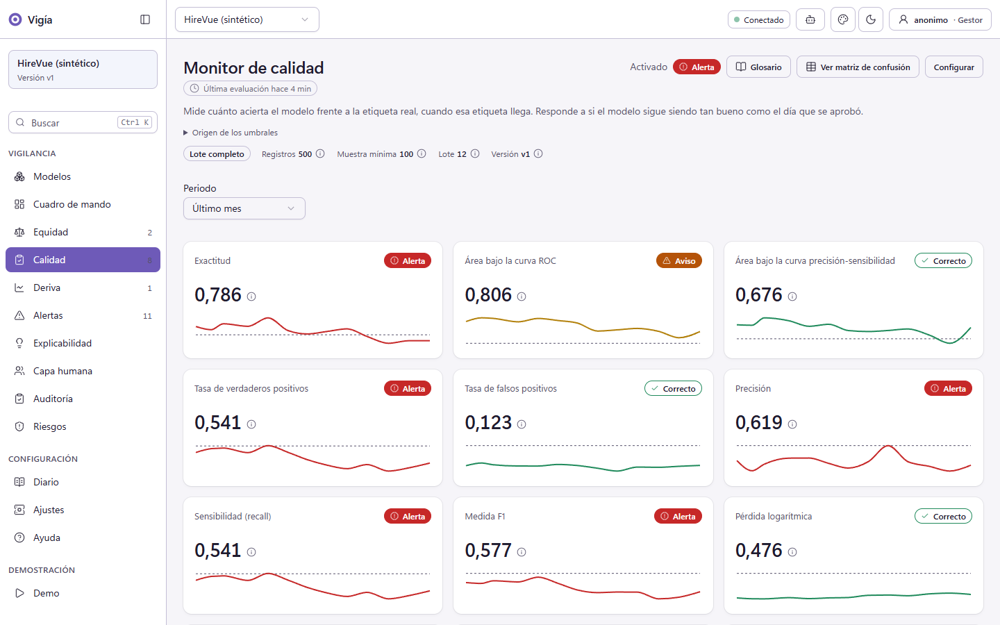
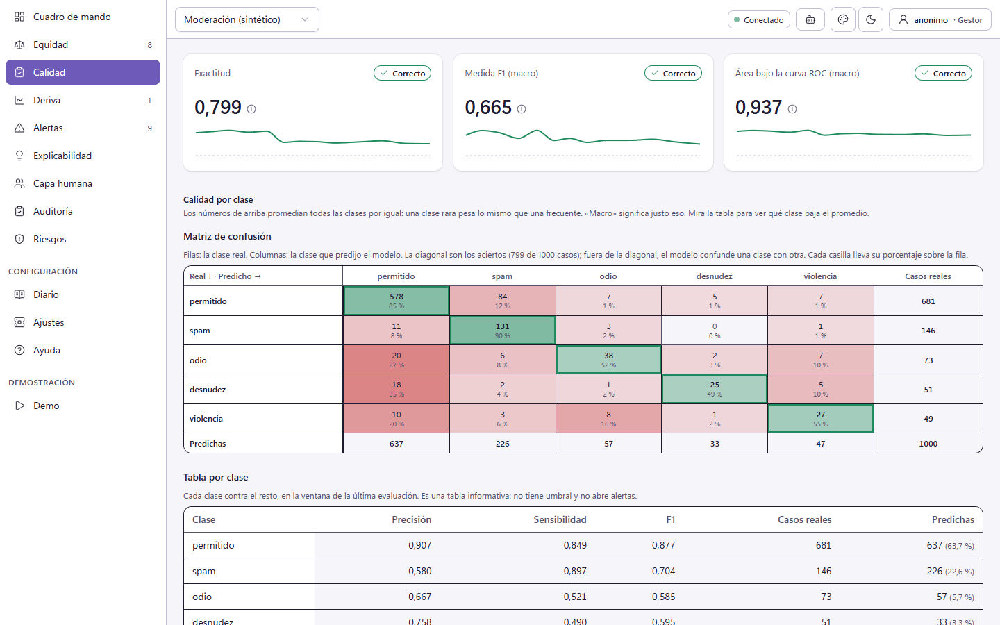
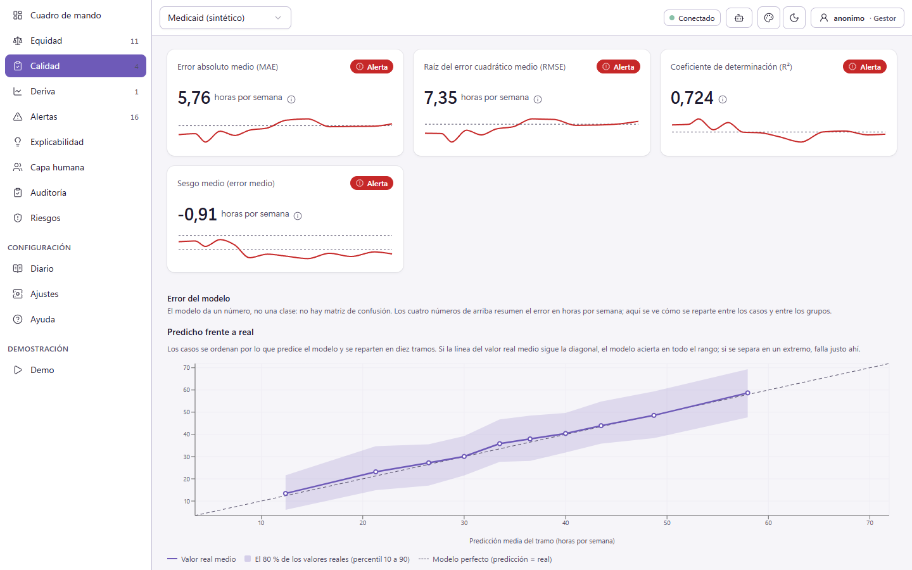

# Vigía

Vigía vigila modelos de IA en producción. Es un programa local para
Windows, sin código: lo arrancas con doble clic y lo usas en el navegador. Mide
la calidad, la equidad entre grupos y la deriva de un modelo, explica sus
decisiones y añade la capa humana: si las personas profesionales dejan de
contrastar al modelo (deskilling), cuánto lo corrigen (overrides) y una auditoría
de la interacción con el sistema.

Funciona con un motor de código abierto que mide equidad, calidad, deriva y
explicabilidad. Un asistente de IA puede
operarlo por MCP, y todo lo que hace queda en el diario.



*Cuadro de mando con datos sintéticos.*

## Datos sintéticos

Los datos de demostración que trae Vigía son **sintéticos**. No contienen datos
de personas reales y se enseñan siempre como tales. Vigía no desidentifica
nada: si lo usas con tus datos, súbelos ya desidentificados.

## Estado

Versión 1.0.0, solo para Windows 11 de 64 bits. Vigía trabaja con datos
tabulares y tres tipos de tarea:

| Tipo de tarea | Qué predice el modelo | Ejemplo |
|---|---|---|
| Binario | Una de dos decisiones | Aprobar o denegar la solicitud de una persona |
| Multiclase | Una entre tres o más clases | Leve, moderada o grave |
| Regresión | Un número | Los días hasta resolver un caso |

Para cada tipo, Vigía mide la calidad, la equidad entre grupos, la deriva y la
explicabilidad con un motor propio de código abierto. Lo que lleva esta versión:

- **Capa humana**: deskilling, overrides, alertas cruzadas y auditoría de la
  interacción, para los tres tipos de tarea.
- **MCP**: un asistente de IA opera Vigía con 39 herramientas.
- **Zip portable**: lleva su propio Python y no pide instalar nada.
- **Siete plantillas** con datos sintéticos, para descargar desde **Ayuda**: línea
  base, lote, etiquetas, registro de uso, outcomes, multiclase y regresión.



*Modelo binario. Los datos son sintéticos.*



*Modelo multiclase. Los datos son sintéticos.*



*Modelo de regresión. Los datos son sintéticos.*

Vigía escucha solo en `127.0.0.1` y no tiene usuarios. Su modelo de seguridad
está en [`SEGURIDAD.md`](SEGURIDAD.md). El manual
([`docs/manual/`](docs/manual/README.md)) dice qué hacer si algo falla.

## Instalación desde el zip

1. Descarga `vigia-1.0.0-win64.zip` y su fichero `vigia-1.0.0-win64.zip.sha256`.
   El `.sha256` va junto al zip, no dentro de él. Comprueba la huella antes de
   extraer (en PowerShell: `Get-FileHash vigia-1.0.0-win64.zip`; el resultado
   debe ser igual al del `.sha256`).
2. Extrae el zip en una carpeta tuya, por ejemplo `C:\Vigia`. Extráelo entero:
   no muevas ficheros sueltos. El zip crea una carpeta anidada
   `vigia-1.0.0-win64\` (por ejemplo `C:\Vigia\vigia-1.0.0-win64\`): `Vigia.cmd`
   está dentro de ella.
3. Haz doble clic en `Vigia.cmd`. Vigía abre el navegador solo.

La primera vez tarda más: Windows escanea los ficheros recién extraídos. Espera
y no lo cierres. Si algo falla, mira `docs\manual\problemas.md` o el capítulo
«Qué hacer si» del manual.

Para ver el registro en una consola, usa `Vigia-consola.cmd`. Para apagar Vigía
con `Vigia.cmd`, abre una consola en la carpeta y escribe:

```
runtime\python\python.exe -m vigia shutdown
```

Con `Vigia-consola.cmd`, cierra la ventana.

La interfaz no tiene botón de apagado. Si arrancaste con `Vigia.cmd` y usaste otra
carpeta de datos, añade `--data-dir <carpeta>` a la orden anterior.

Tus datos quedan en `Documents\vigia-datos`. Para cambiar la carpeta, pásala
como argumento (`Vigia.cmd D:\mis-datos`) o fija la variable `VIGIA_HOME`. Para
ver qué carpeta usa tu copia, abre **Ajustes**: el bloque «Carpeta de datos» la
muestra y la copia al portapapeles.

Los ficheros que exportas (por ejemplo, el diario en **Diario**) los descarga el
navegador: caen en su carpeta de descargas (normalmente `Descargas`), no en la
carpeta de datos de Vigía.

Vigía no lleva firma digital. Si el Control de aplicaciones inteligente de
Windows u otro antivirus bloquea un fichero, mira «Qué hacer si» en el manual.

## Primeros pasos

1. En el menú, abre **Demo** para ver Vigía con un caso sintético completo, sin
   preparar nada.
2. Para vigilar un modelo tuyo, abre **Modelos** y pulsa «Crear modelo». El
   asistente de alta te pide el nombre, la etapa y un fichero de ejemplo.
3. Sube la línea base, fija los umbrales y sube un lote de producción.
4. Abre **Ayuda**: lleva la guía de uso y la guía de datos, con las columnas de
   cada fichero y siete plantillas con datos sintéticos para descargar.

Los ficheros pueden ser CSV (coma, punto y coma o tabulador) o JSON. Si tus datos
están en Excel, guárdalos como CSV.

## Revisión del dossier con modelo

La revisión rápida de un dossier funciona siempre, en tu equipo y sin clave. La
revisión con modelo de lenguaje está desactivada por defecto y, con el backend
«anthropic», pide una clave de API que escribes en Ajustes. **Sin clave, esa
revisión no corre y todo lo demás funciona.** El texto del dossier sale hacia el
proveedor del modelo: confirma antes que no lleva datos de personas afectadas.

## Uso por MCP

Un asistente que hable MCP (Claude Code, Claude Desktop) puede leer y operar
Vigía con 39 herramientas. Arranca Vigía antes de abrir el asistente. El
servidor MCP habla solo con tu copia local. Hay un ejemplo de configuración,
la lista de herramientas y las reglas de confirmación en
[`docs/mcp.md`](docs/mcp.md).

Lo que el asistente lee pasa por su proveedor. Usa solo datos que puedas
compartir con él.

## Manual

El manual está en [`docs/manual/`](docs/manual/README.md): instalación, guía de
uso, guía de datos y qué hacer si algo falla. La API tiene su esquema en
`docs/api/openapi.json`.

## Compilar desde el código

Hace falta el Python 3.13 del sistema (el instalado desde python.org, no uno
descargado por una herramienta), [uv](https://docs.astral.sh/uv/) y Node 20.19 o
superior. Desde la raíz del repositorio:

```
uv sync --locked --extra dev --extra shap
cd frontend
npm ci
$env:VITE_TEMA="miguel"
npm run build
cd ..
.venv\Scripts\python.exe build\build.py all
```

Las órdenes están escritas para PowerShell. En `cmd`, la línea de la variable
es `set VITE_TEMA=miguel`.

`npm run build` deja la interfaz en `src/vigia/static`. `build.py all` descarga
el Python embebido (y comprueba su huella sha256 fijada en el script), instala
las dependencias del lock y deja el zip en `dist\`. Si el
Python 3.13 del sistema no es el que resuelve el entorno, indica su `python.exe`
en la variable `VIGIA_PYTHON_SISTEMA`. Más detalle en
[`build/README.md`](build/README.md).

## Seguridad

Vigía escucha solo en `127.0.0.1` y no tiene usuarios. El modelo de seguridad y
las buenas prácticas están en [`SEGURIDAD.md`](SEGURIDAD.md).

## Licencia

MIT. Mira [`LICENSE`](LICENSE). El software y los datos de terceros que lleva el
código fuente están en [`NOTICE`](NOTICE).
